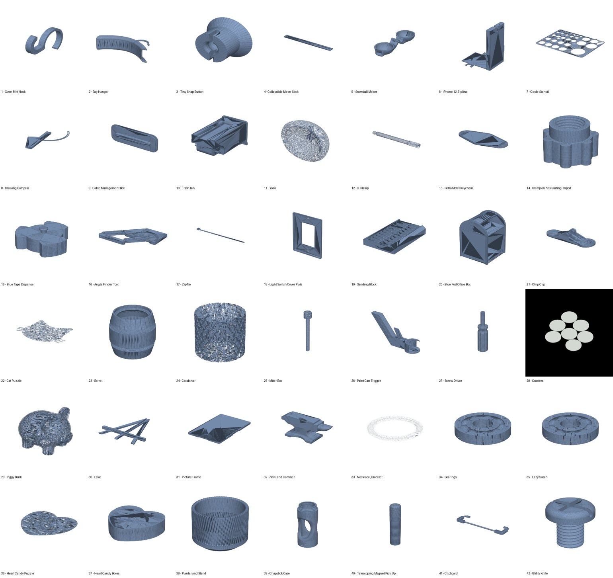
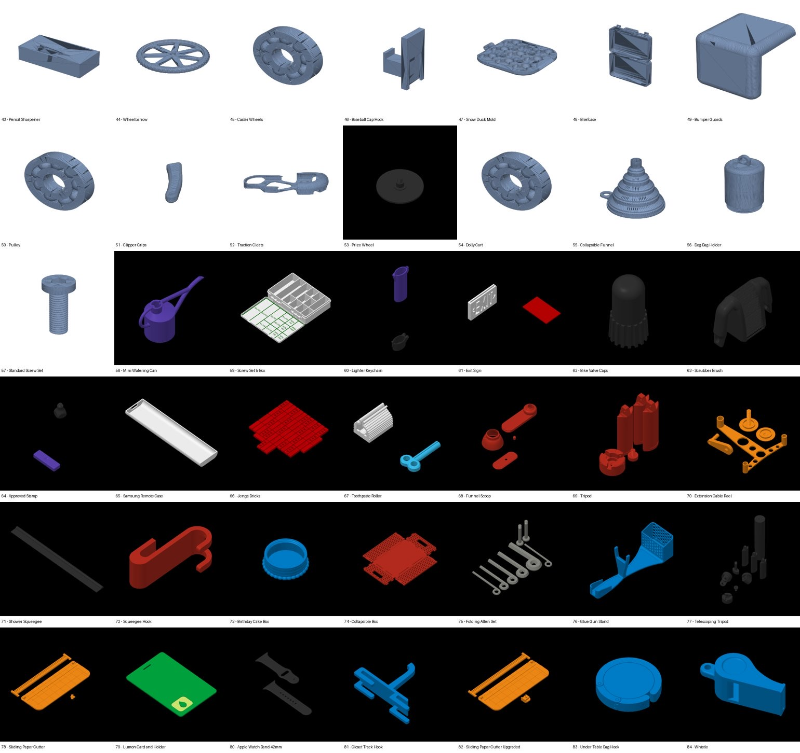
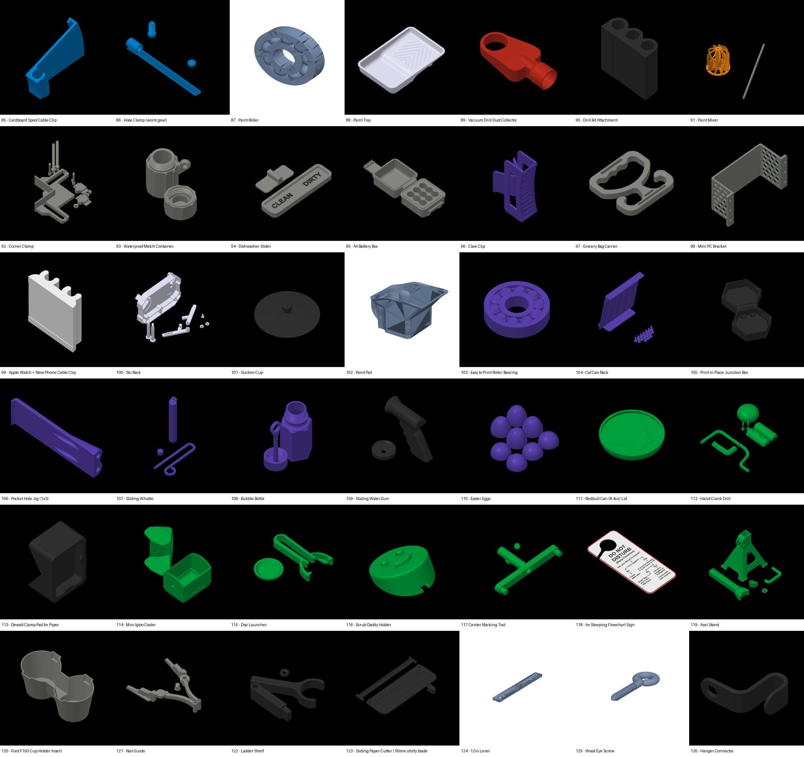
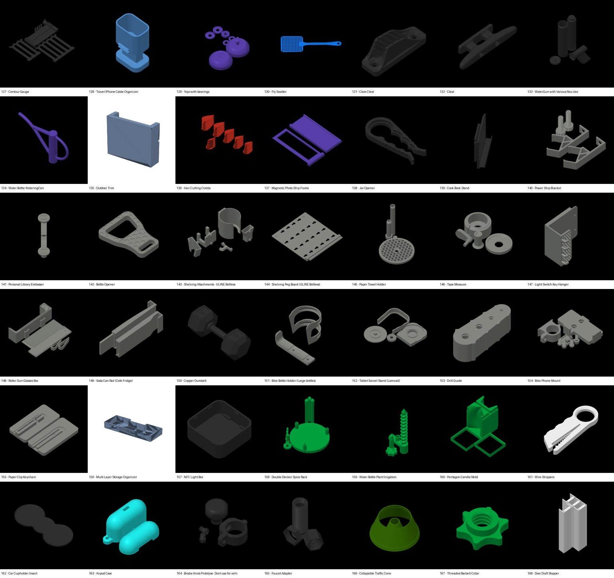
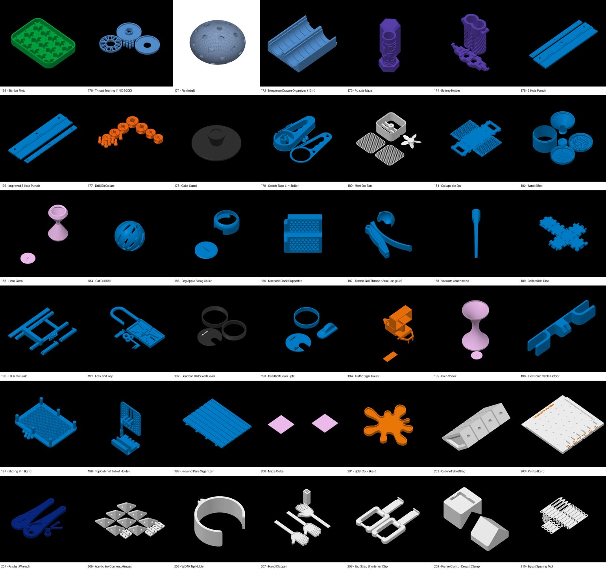
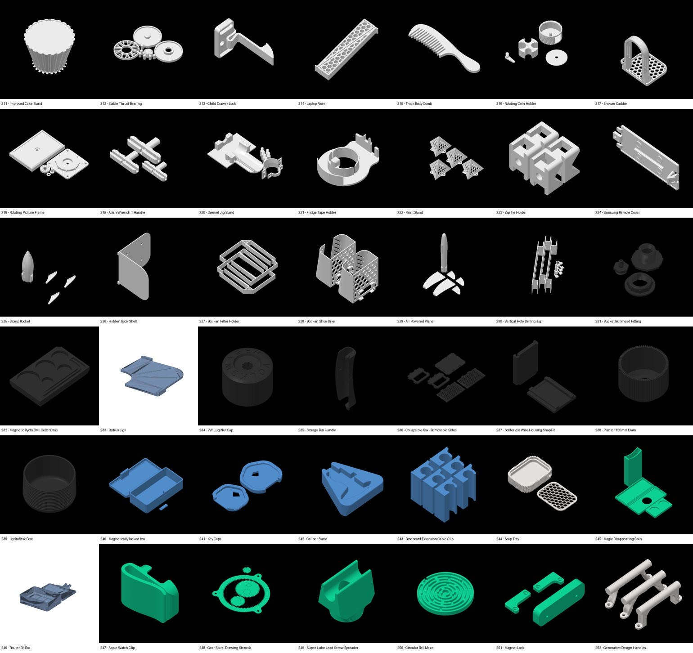
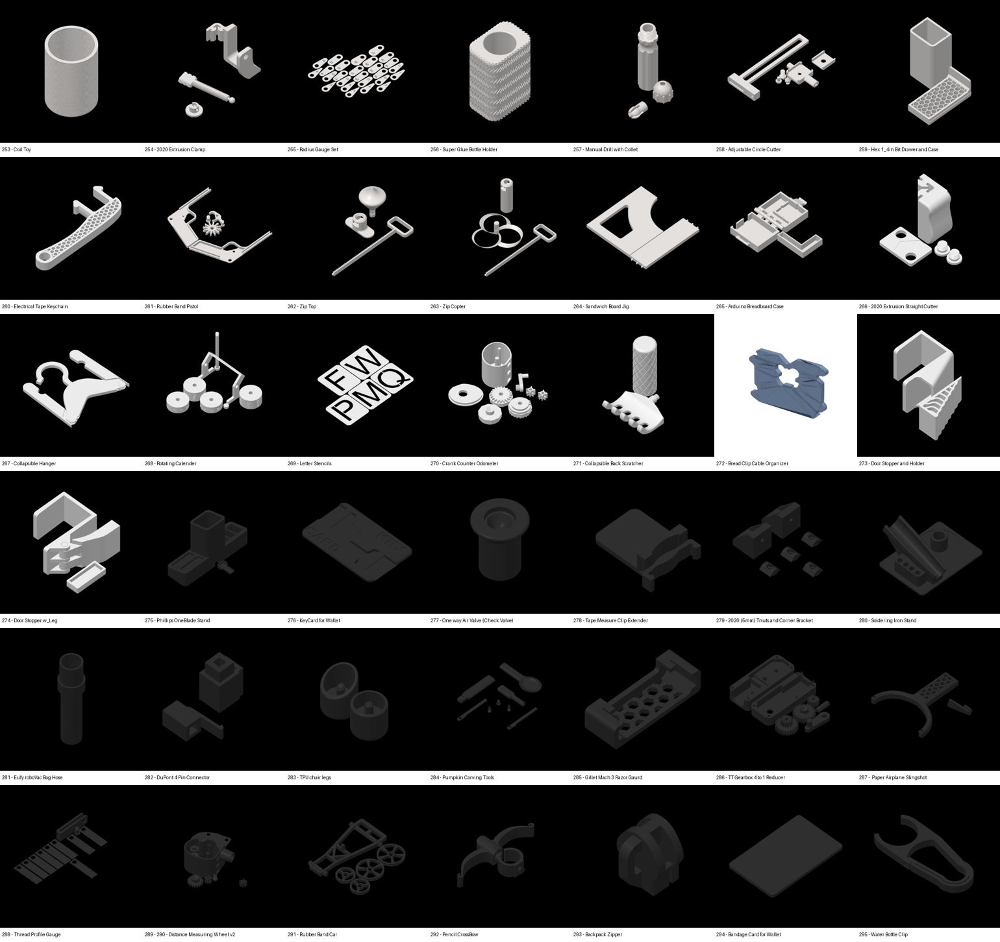
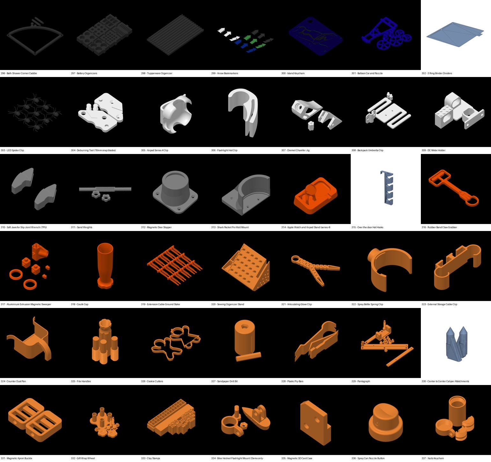
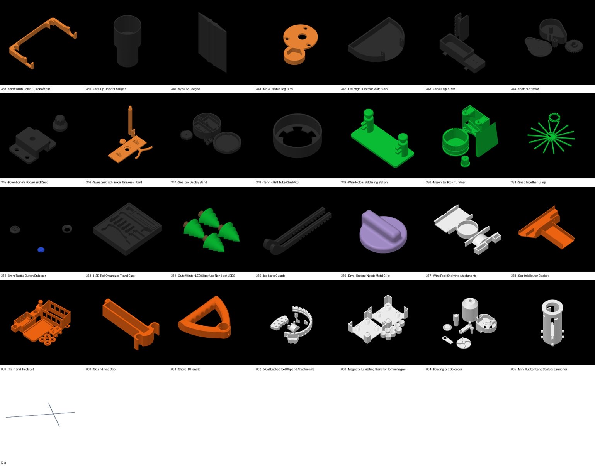
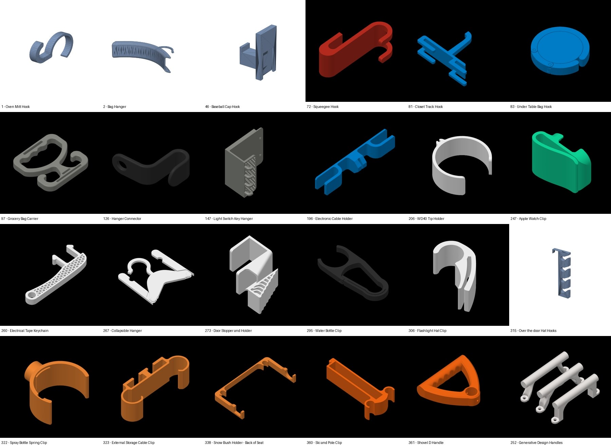

# Charlie Design 371개 분석 — 3D 출력용 실용품의 형태 문법

`~/Hub/60_3D Print/Charlie Design/` 의 압축 파일 371개(STL 2,145 · 3mf 620)를 2026-11-07 전부 열어, 제품마다 대표 그림을 한 장씩 만들어 보고 걸이 · 고리 18개는 실제 치수를 쟀다.
`design-language.md`(허먼밀러 · 애플)가 **어떤 인상**을 낼지 정한다면, 이 문서는 **3D 프린터로 뽑는 물건이 그 인상을 어떻게 갖는지** — 굵기 · 단면 · 출력 방향을 정한다. 둘이 부딪히면 강도 · 출력 쪽은 이 문서가 이긴다.
그림은 `design-refs/charlie-*.jpg`.

## 1. 전체 모음

종류는 눈으로 나누면 크게 넷이다 — 집안 걸이 · 집게 · 정리함, 공구 · 지그(작업 보조 틀), 장난감 · 손장난감, 기계 부품(베어링 · 기어 · 나사). 장식만 하는 물건은 거의 없다.

## 2. 걸이 · 고리만 모아 보기

실제로 잰 치수 (STL 외곽 상자, 작은 값부터):

| 제품 | 치수 (mm) | 가장 작은 값 = 두께(밀어 올린 폭) |
| --- | --- | --- |
| 72 Squeegee Hook (밀대 걸이) | 40 × 52 × 100 | **40** |
| 361 Shovel D Handle (삽 손잡이) | 30 × 124 × 140 | **30** |
| 360 Ski and Pole Clip (스키 걸이) | 30 × 65 × 136 | **30** |
| 196 Electronic Cable Holder | 27 × 28 × 165 | **27** |
| 323 External Storage Cable Clip | 26 × 30 × 89 | **26** |
| 306 Flashlight Hat Clip | 25 × 41 × 57 | **25** |
| 247 Apple Watch Clip | 22 × 38 × 52 | **22** |
| 322 Spray Bottle Spring Clip · 206 WD40 Holder | 20 × 35 × 39 · 20 × 48 × 49 | **20** |
| 315 Over the door Hat Hooks | 20 × 100 × 342 | **20** |
| 126 Hanger Connector | 18 × 37 × 44 | **18** |
| 1 Oven Mitt Hook · 295 Water Bottle Clip · 83 Under Table Bag Hook | 6 × 36 × 54 · 6 × 32 × 75 · 8 × 46 × 47 | 6~8 (가벼운 것 · 휘어야 하는 것만) |

## 3. 형태 문법 10가지

| # | 문법 | 보이는 곳 |
| --- | --- | --- |
| 1 | **옆에서 본 윤곽 하나를 넓게 밀어 올린다.** 걸이 대부분이 2D 윤곽을 18~40 mm 폭으로 민 기둥 모양이다 | 72 · 247 · 322 · 323 · 360 · 361 |
| 2 | **폭이 두껍고 벽은 적당하다.** 밀어 올린 폭 20~40, 윤곽의 벽 두께는 5~8. 「얇은 판을 세운」 것이 아니라 「넓은 띠를 접은」 것이다 | 72 · 206 · 322 · 360 |
| 3 | **벽 두께가 끝까지 같다.** 꺾이는 곳도 안쪽 · 바깥쪽 둥글기가 같은 중심이라 굵기가 안 변한다 | 72 · 206 · 306 · 322 |
| 4 | **윤곽 둥글기는 크고, 면 모서리는 작다.** 옆에서 본 윤곽은 반지름 10~25 로 크게 굴리고, 밀어 올린 면의 모서리는 1~2 로만 다듬는다 | 247 · 361 · 72 |
| 5 | **물건을 감싸는 C 자.** 기둥 · 병 · 손잡이에 끼울 때 원의 약 270° 를 감싸 탁 끼우는 집게로 만든다. 나사를 안 써도 된다 | 206 · 322 · 306 · 323 · 360 |
| 6 | **끝은 둥글게 말거나 공처럼 두툼하게.** 물건이 걸리는 끝은 반원으로 닫거나 조금 부풀린다. 날카로운 끝이 없다 | 72 · 126 · 295 · 247 |
| 7 | **구멍 뚫린 무늬는 기능이 있을 때만.** 육각 구멍(벌집)은 무게를 줄이거나 물이 빠지게 할 때, 손잡이엔 홈 · 오돌토돌 무늬 | 260 · 214 · 217 · 97 · 361 |
| 8 | **바닥이 평평하고 받침 없이 뽑힌다.** 넓은 면이 판에 눕고, 돌출은 45° 이하, 바닥 모서리는 살짝 깎는다 | 거의 전부 |
| 9 | **기계 장치로 해결한다.** 경첩 · 끼움 · 나사산 · 자석 · 용수철을 출력물 안에 넣고, 장식은 그 장치가 대신한다 | 105 · 267 · 274 · 331 · 240 |
| 10 | **색 하나, 진하게.** 제품마다 한 색(주황 · 파랑 · 초록 · 검정 · 흰색)으로 통째 뽑는다. 글자는 음각 · 양각으로 같은 색 | 94 · 118 · 234 |

## 4. 지금 옷걸이 시안과 다른 점

| | 내 방향 A 시안 (2026-11-07) | Charlie 의 걸이 |
| --- | --- | --- |
| 밀어 올린 폭 | **8** | **20~40** |
| 윤곽 벽 두께 | 20 (판을 세움) | 5~8 |
| 인상 | 얇은 철판 | 손에 쥐어지는 두툼한 띠 |
| 기둥에 붙는 법 | 원통 고리에 판을 붙임 | 고리 자체가 C 자 윤곽의 일부 — 고리와 걸이가 **한 윤곽** |

「너무 얇기만 하다」 는 느낌의 원인은 1 행이다. 판 높이(20)는 충분했지만 옆에서 보이는 폭이 8 이라 가늘어 보였다.

## 5. 옷걸이 부속에 옮길 규칙

1. **한 윤곽으로 그린다.** 옆에서 본 윤곽에 기둥을 감싸는 고리(원 + 벽 6)와 걸이를 한 선으로 잇고, 그것을 **폭 24** 로 밀어 올린다. 고리와 걸이 사이에 이음이 없다.
2. **벽 두께 7 을 끝까지 같게.** 꺾이는 곳 안쪽 반지름 8 이상, 바깥 = 안쪽 + 7.
3. **윤곽 둥글기는 크게(반지름 ≥ 10), 면 모서리는 1.5.**
4. **걸리는 끝은 반원으로 닫고, 가방 · 신발처럼 무거운 것은 끝을 조금 부풀린다**(벽 7 → 10).
5. **출력은 윤곽 면을 판에 눕혀서** — 굽힘을 층 안에서 받고, 받침이 필요 없다. 기둥 구멍은 위아래로 서게 된다(원래대로).
6. 허먼밀러 쪽 규칙(색 하나 · 꺾임 하나 · 줄 맞춤 · 기능 하나만 장식)은 그대로 지킨다.
